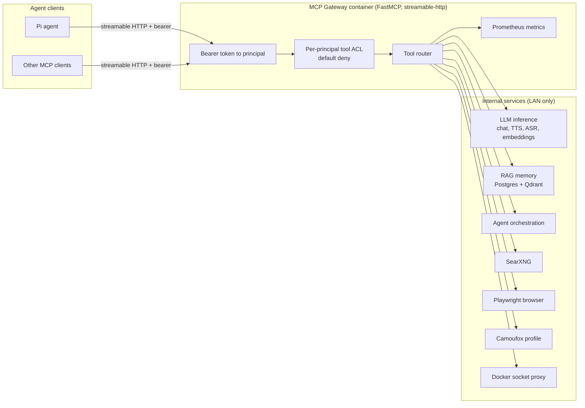

<div align="center">

# MCP Gateway

**The AI agent tool bridge: internal services exposed as standardized MCP tools behind one authenticated endpoint**

[]()
[]()
[]()
[]()

</div>

> **Documentation mirror.** The deployed implementation lives in a private repository. This repository
> carries the architecture, the tool reference, the design decisions and the measurements. For source
> access, contact me.

## Architecture



The gateway is the only externally reachable component. Every backing service is bound to the LAN, so
the estate has one authenticated door instead of nine.

## What it is

A single MCP endpoint that translates internal services into standardized tools, so an agent needs one
transport, one credential and one tool namespace instead of a client per service.

- **53 tool definitions**, of which **42 are advertised** to the default principal. The
  difference is the ACL, not a bug: a principal only sees the tools it is granted.
- **Tool set:** agent orchestration, GPU inference (chat, TTS, ASR, embeddings), RAG memory, web search
  and research, browser and anti-detect browser control, YouTube and media transcription, read-only
  Docker through a socket proxy, host and retention status, email drafting with a human approval
  gate.
- **Transport:** MCP `streamable-http` via FastMCP, one POST endpoint, SSE responses, session-aware.
- **Identity:** bearer token mapped to a named principal; per-principal tool allowlist; default deny.
- **Observability:** Prometheus metrics for tool calls, upstream failures, cache behaviour and process
  state.

## Tool reference

<!-- TOOLS:START -->
53 tools are defined. A principal is advertised only the ones its access list grants,
so the count a caller sees can be lower.

| Surface | Tools | Effects |
|---|---:|---|
| [Agent orchestration](#agent-orchestration) | 3 | read, write, external |
| [Anti-detect browser](#anti-detect-browser) | 9 | read, write, destructive, external, rate-limited, idempotent |
| [Browser](#browser) | 7 | read, write, destructive, external, idempotent |
| [Docker](#docker) | 2 | read |
| [Email](#email) | 4 | read, write, external, idempotent |
| [External review](#external-review) | 2 | read, compute |
| [GPU inference](#gpu-inference) | 5 | read, compute |
| [Gateway](#gateway) | 2 | read |
| [Media](#media) | 4 | read, external, rate-limited |
| [RAG memory](#rag-memory) | 8 | read, write, destructive, idempotent |
| [Research](#research) | 1 | read, external, rate-limited |
| [Retention](#retention) | 1 | read |
| [Search](#search) | 4 | read, external, rate-limited |
| [System](#system) | 1 | read |
| **Total** | **53** | |

`Effect` comes from each tool's own MCP annotations: `read` cannot change state, `write`
can, `destructive` can lose data, `external` leaves the host. `rate-limited` means an
immediate repeat leans on an upstream that throttles us.

### Agent orchestration (3)

| Tool | What it does | Effect |
|---|---|---|
| `langgraph_agents` | List the LangGraph agent definition (model + available tools). | read |
| `langgraph_health` | Check the LangGraph agent service health. | read |
| `langgraph_run` | Run the LangGraph agent. | write, external |

### Anti-detect browser (9)

| Tool | What it does | Effect |
|---|---|---|
| `camo_click` | Click an element matching the CSS selector in the Camoufox browser. | destructive, external |
| `camo_close` | Close the calling client's Camoufox page immediately. | write, idempotent |
| `camo_content` | Return the visible text of the current Camoufox page (truncated). | read |
| `camo_evaluate` | Run JavaScript in the current Camoufox page and return the result. | destructive, external |
| `camo_fingerprint` | Report the Camoufox browser fingerprint (UA, webdriver flag, canvas, etc.) and validate it against the pinned profile (rule 9: validate at runtime). | read |
| `camo_navigate` | Open a URL in the Camoufox anti-detection browser (patched Firefox). | read, external, rate-limited |
| `camo_screenshot` | Take a screenshot of the current Camoufox page. | read |
| `camo_search` | Search the web through the anti-detect Camoufox browser (persistent fingerprint). | read, external, rate-limited |
| `camo_type` | Type text into an input matching the CSS selector in the Camoufox browser. | destructive, external |

### Browser (7)

| Tool | What it does | Effect |
|---|---|---|
| `browser_click` | Click an element matching the CSS selector. | destructive, external |
| `browser_close` | Close the calling client's browser page and context immediately. | write, idempotent |
| `browser_content` | Return the visible text of the current page (truncated). | read |
| `browser_evaluate` | Run JavaScript in the current page and return the result. | destructive, external |
| `browser_navigate` | Open a URL in the headless browser. | read, external |
| `browser_screenshot` | Take a screenshot of the current page. | read |
| `browser_type` | Type text into an input matching the CSS selector. | destructive, external |

### Docker (2)

| Tool | What it does | Effect |
|---|---|---|
| `docker_logs` | Fetch recent logs of a docker container on the gateway host. | read |
| `docker_ps` | List docker containers on the gateway host. | read |

### Email (4)

| Tool | What it does | Effect |
|---|---|---|
| `email_approve` | Approve and send a pending email. | write, external |
| `email_cancel` | Cancel a pending email you drafted (remove the draft). | write, idempotent |
| `email_pending` | List your own emails drafted (pending) awaiting human approval. | read |
| `email_send` | Draft an email for sending: does not send. | write |

### External review (2)

| Tool | What it does | Effect |
|---|---|---|
| `external_review` | Ask an external frontier model for feedback on a hard question. | read, compute |
| `external_status` | Report the external reviewer's configuration and health: which model, the retry/deadline budget, whether the key is present (never its value), and the upstream latency/outcome counters for it. | read |

### GPU inference (5)

| Tool | What it does | Effect |
|---|---|---|
| `gpu_chat` | Chat completion via LiteLLM GPU server. | read, compute |
| `gpu_embed` | Embed text with bge-m3 (1024 dims) on the LiteLLM GPU server. | read |
| `gpu_models` | List models available on the LiteLLM GPU server. | read |
| `gpu_stt` | Speech-to-text with parakeet-asr-stt via LiteLLM. | read, compute |
| `gpu_tts` | Text-to-speech with kokoro-tts via LiteLLM. | read, compute |

### Gateway (2)

| Tool | What it does | Effect |
|---|---|---|
| `gateway_info` | Which build of this gateway you are talking to, right now. | read |
| `server_instructions` | How to use this MCP server: rules, tool ordering, and gotchas. | read |

### Media (4)

| Tool | What it does | Effect |
|---|---|---|
| `media_transcribe` | Transcript of a recording, choosing the cheap rung first. | read, external, rate-limited |
| `yt_audio` | Download a YouTube video's AUDIO and hand back a path `gpu_stt` can read.). | read, external, rate-limited |
| `yt_transcript` | Fetch a YouTube video's transcript (manual subtitles first, auto-generated fallback). | read, external, rate-limited |
| `yt_video_info` | Get a YouTube video's metadata and available subtitle languages. | read, external, rate-limited |

### RAG memory (8)

| Tool | What it does | Effect |
|---|---|---|
| `memory_delete` | SOFT DELETE a memory (tags it 'trash'). | destructive |
| `memory_purge_trash` | PERMANENTLY delete all trash-tagged memories. | destructive |
| `memory_restore` | Restore a soft-deleted (trash-tagged) memory. | write, idempotent |
| `memory_search` | Search memories in the RAG memory API (the calling principal's own space). | read |
| `memory_stats` | Get memory statistics for the calling principal. | read |
| `memory_store` | Store a memory in the RAG memory API (the calling principal's own space). | write |
| `memory_update` | Update a memory's content (regenerates its embedding). | write, idempotent |
| `memory_verify` | Verify a memory exists and belongs to the calling principal (before delete/update). | read |

### Research (1)

| Tool | What it does | Effect |
|---|---|---|
| `research` | Run research at a chosen tier (1-4). | read, external, rate-limited |

### Retention (1)

| Tool | What it does | Effect |
|---|---|---|
| `retention_status` | Show generated-data usage and what a retention cleanup would remove. | read |

### Search (4)

| Tool | What it does | Effect |
|---|---|---|
| `research_fetch` | OpenAI-style FETCH tool. | read, external, rate-limited |
| `research_menu` | List the research tiers. | read |
| `research_search` | OpenAI-style SEARCH tool. | read, external, rate-limited |
| `searxng_search` | Metasearch via the local SearXNG instance (aggregates google cse, bing, duckduckgo, wikipedia, brave, startpage, mojeek, qwant). | read, external |

### System (1)

| Tool | What it does | Effect |
|---|---|---|
| `system_status` | Host status of the gateway host: load, uptime, memory, disk. | read |
<!-- TOOLS:END -->

Counts and effects are generated from the deployed `server.py` by
[`scripts/extract_tools.py`](scripts/extract_tools.py) (`--check` fails when this section is stale), so the
table cannot drift silently from the source.

## Quick Start

```bash
# 1. configuration: copy the template and fill in the values you need
cp .env.example .env

# 2. run it
docker compose up -d --build

# 3. check it
curl -s -o /dev/null -w '%{http_code}\n' \
  -H "Authorization: Bearer $MCP_AUTH_TOKEN" \
  http://<gateway-host>:<port>/mcp   # 401 without a token, 200/406 with one
```

Minimum configuration to start: `MCP_PORT`, `MCP_AUTH_TOKEN`, and the upstream URLs you intend to use
(the upstream URL variables). `server.py` reads 104 environment keys. 101 of them are named in
[`.env.example`](.env.example), 81 as live assignments and 20 as commented opt-in examples; the other
three are build-identity values the image stamps for itself, described there rather than named, since
they are image metadata and not runtime configuration. `scripts/check_public_counts.py` re-derives
every one of those numbers from the deployed source, so the sentence cannot drift again.

To run without the ACL (single-tenant development only), leave `MCP_PRINCIPALS` and `MCP_ACL` unset,
which is the documented rollback path.

## What Broke / Challenges

**A silent empty result that looked like a working call.** Clients read MCP results through an adapter
with a fixed details ceiling. When a tool returned more than that ceiling, the transport replaced the
payload with a shape-compatible summary, so a caller doing `results || []` saw an empty list. The call
had succeeded, the data existed, and the agent reported "nothing found". It was measured three times
before it was believed, and the belief that survived longest was the wrong one: that the memory service
was broken. The fix was a version floor on the adapter that returns an explicit
`intermediate_result_too_large` error instead of a stub, plus a caller rule: check the omission flag
before trusting the shape. **A truncated result must never be silent**, because an empty result produced
by truncation is worse than an error.

**A pinned dependency that broke the browser tools.** `camoufox` was pinned at 0.5.4 because a rebuild
resolved 0.5.5, which fetched browser build 152.0.4-beta.29 while the durable fingerprint profile still
pointed at -beta.28. Every `camo_*` tool then failed with "Failed to launch firefox because executable
doesn't exist". The lesson was not "pin versions" in the abstract: the browser build is chosen by
camoufox's own CLI, so the pin has to cover that too, and the combination has to be proven in a
throwaway container before the image is rebuilt. `requirements.txt` now records the failure next to the
pins.

**A 524 that did not mean the work stopped.** A long transcription returned HTTP 524 at the edge while
the request stayed parked upstream, holding threads and gigabytes of memory on the host that also served
the chat model, so the queue behind it stopped draining. The fix was operational: probe the queue before
posting, keep one request in flight, size each request to a deadline, and on a 524 stop the batch rather
than retry into a queue already holding the first copy.

**An ACL denial that looked like success.** A denied call is returned as ordinary text
(`tool 'x' is not permitted for principal '<id>'`), not as an error result. A client checking only
`isError` treats a refused call as a success. This is recorded as a known limitation below, because the
contract is currently shaped that way.

## Known Limitations

- **Single host, single site, no redundancy.** The gateway is a `docker compose` service on one machine.
  A host failure is a full outage; there is no failover and no replica.
- **An ACL denial is not an error result.** Denials arrive as text content. A client must inspect the
  content, not only `isError`, or it will treat a refusal as a success.
- **Empty input is sometimes accepted rather than rejected.** `memory_search` with an empty query
  returns top hits; `gpu_embed` with empty text returns a 1024-dimension vector. Both are documented
  behaviours, and both are worth validating at the caller if the distinction matters.
- **No response cache except exact-query search.** Search results are cached (30 s, single-flight); GPU,
  RAG and browser calls are not cached at all. A repeated embedding costs the same as the first one.
- **Per-request cost is not billed or metered per caller.** There is no quota per principal, only a rate
  limit on the RAG surface and admission control ahead of external providers.
- **The external reviewer path is the only paid lane.** It is bounded by attempts and a deadline, but its
  cost is not attributed per caller.
- **Tool errors are not uniformly typed.** Some arrive as exceptions, some as `isError`, some as a JSON
  payload with an `error` key, some as plain text. A caller needs all four shapes; normalizing them is
  the obvious next improvement.
- **At scale this would need** a real secret store instead of a `.env`, per-caller quotas, a queue in
  front of long-running media work, and horizontal session affinity for the stateful browser tools.

## Evidence

- [EVALUATION.md](EVALUATION.md): measured latency, failure rates and a 20-case guardrail evaluation, with
  the harness and the date of measurement.
- [DECISIONS.md](DECISIONS.md): why streamable-http, why per-principal ACLs, why the search cache is the
  only cache, and what each choice costs.
- [cards/](cards/): model card and data card for the models and the memory store behind the tools.

## Security model

| Control | How it works |
|---|---|
| Identity | Bearer token mapped to a principal via `MCP_PRINCIPALS`; unmapped tokens are rejected |
| Authorisation | Per-principal tool allowlist, default deny; the advertised tool list is filtered per principal |
| Egress | SSRF guard on browser and fetch tools: loopback, link-local, metadata addresses and non-http schemes are refused |
| Destructive actions | Email is drafted, never sent, until a human supplies the approval token |
| Docker | Accessed through a socket proxy on loopback, not the raw daemon socket: two read verbs allowed, writes refused |
| Rate limiting | Per-agent ceiling on the RAG surface; admission control ahead of external providers |
| Retention | Generated artefacts are reported by `retention_status` and pruned after `RETENTION_DAYS` |

## Deployment

Push to `main` builds the image, the host pulls and restarts the container, and a health check calls
`POST /mcp`. The runtime is a digest-pinned Python 3.14 image; dependency pins live in
[`requirements.txt`](requirements.txt) with the reason for each pin recorded next to it.

## Status

This is infrastructure for one operator's own agents, and the documentation says so rather than
implying a hosted product. The measurements in EVALUATION.md are from a single host on a single day.
