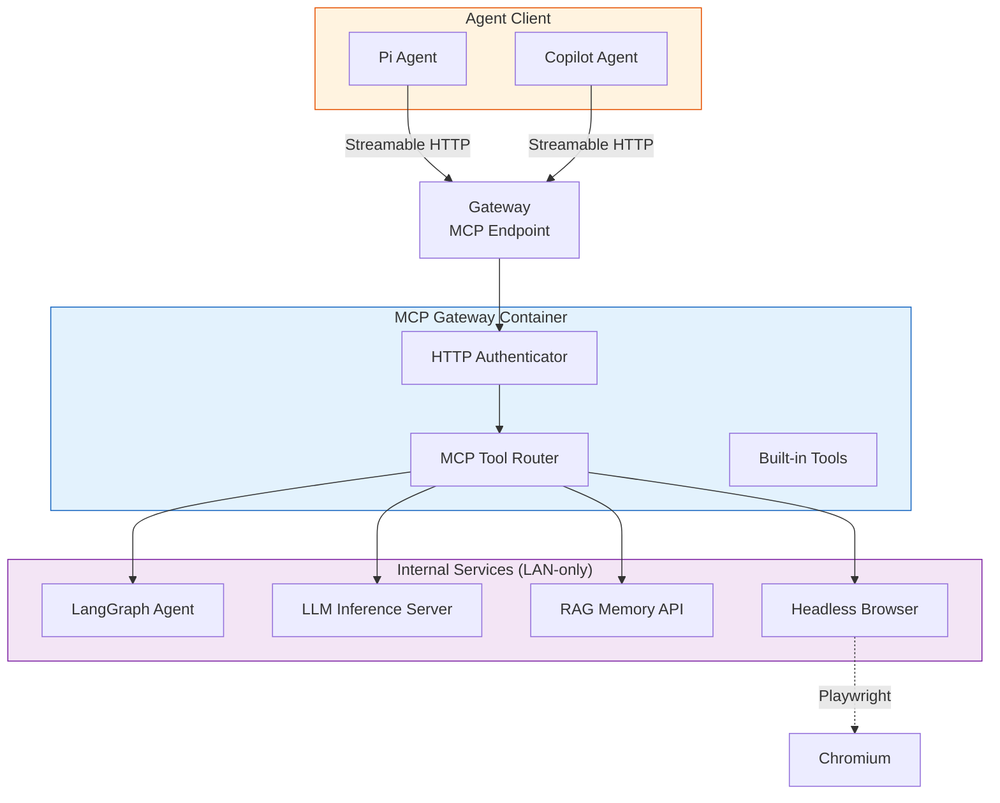
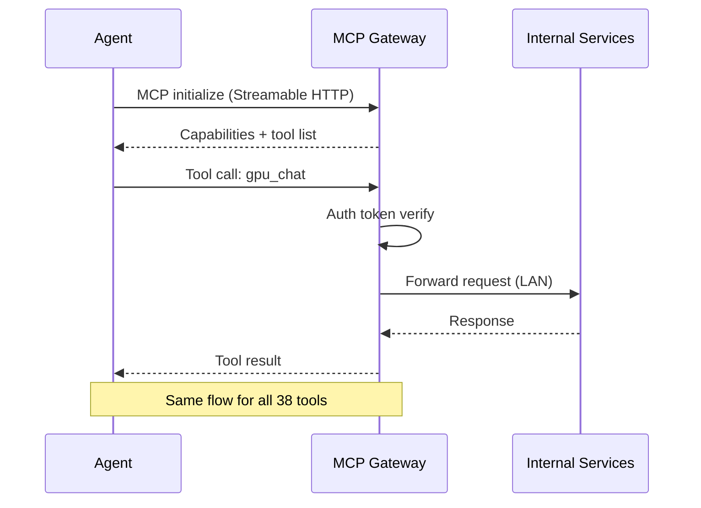
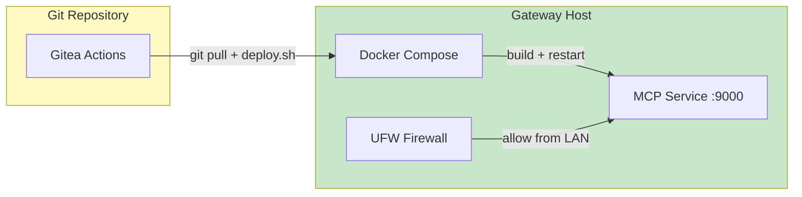

<div align="center">

# 🚀 MCP Gateway

**The AI Agent Tool Bridge — exposing internal services as standardized MCP tools**

[]()
[]()
[]()
[]()

</div>

---

## 📌 What It Is

A **production-grade MCP gateway** that translates internal microservices into standardized Model Context Protocol (MCP) tools — letting AI agents interact with GPUs, memory, browsers, and agent orchestration through a single unified interface.

**One endpoint. Forty tools. Zero agent-level boilerplate.**

## 🏗️ Architecture



## 🧰 Available Tools

| Category | Tool | Capability |
|----------|------|------------|
| **LLM Inference** | `gpu_chat` | Chat completion with configurable models |
| **LLM Inference** | `gpu_models` | List available models |
| **Agent Orchestration** | `langgraph_run` | Execute multi-step agent workflows |
| **Agent Orchestration** | `langgraph_agents` | Discover agent definitions |
| **Agent Orchestration** | `langgraph_health` | Service health check |
| **Memory (RAG)** | `memory_store` | Store a memory with type classification |
| **Memory (RAG)** | `memory_search` | Semantic search across stored memories |
| **Memory (RAG)** | `memory_stats` | Retrieve memory statistics for an agent |
| **Memory (RAG)** | `memory_update` | Update a stored memory |
| **Memory (RAG)** | `memory_delete` | Soft-delete a memory (trash) |
| **Memory (RAG)** | `memory_restore` | Restore a memory from trash |
| **Memory (RAG)** | `memory_purge_trash` | Permanently delete trashed memories |
| **Memory (RAG)** | `memory_verify` | Validate stored memory content |
| **Browser** | `web_fetch` | Fetch URL content with rendered HTML |
| **Browser** | `web_search` | Metasearch across engines |
| **Browser** | `web_scrape` | Extract structured data from pages |
| **Browser** | `web_page_tool` | Execute JavaScript in a browser page |
| **Browser** | `yt_transcript` | Extract YouTube video transcripts |
| **Docker** | `docker_container_list` | List running containers |
| **Docker** | `docker_container_inspect` | Inspect a container |
| **Docker** | `docker_exec` | Execute commands in containers |
| **Docker** | `docker_logs` | Stream container logs |
| **Docker** | `docker_image_list` | List container images |
| **SSH** | `ssh_command` | Execute SSH commands on remote hosts |
| **SSH** | `ssh_file_read` | Read files over SSH |
| **SSH** | `ssh_file_write` | Write files over SSH |
| **SSH** | `ssh_file_delete` | Delete files over SSH |
| **SSH** | `ssh_dir_list` | List remote directories |
| **System** | `system_command` | Execute commands on the gateway host |
| **System** | `system_env_info` | Runtime environment diagnostics |
| **Memory** | `memory_context_assemble` | Build full context window from memories |
| **Memory** | `memory_link` | Create bidirectional memory links |
| **Memory** | `memory_graph` | Navigate memory relationship graphs |
| **Memory** | `memory_namespace_list` | List memory namespaces |
| **Memory** | `memory_agent_stats` | Per-agent memory statistics |
| **Memory** | `memory_audit` | Retrieve audit logs |
| **Embedding** | `embeddings_dense` | Generate dense embeddings |
| **Embedding** | `embeddings_sparse` | Generate sparse embeddings |
| **Embedding** | `embeddings_hybrid` | Generate hybrid embeddings |

## 🔄 How It Works



Every tool call follows the same pipeline:

| Step | Action |
|------|--------|
| **1** | Agent sends a JSON-RPC MCP tool call to the gateway |
| **2** | Gateway verifies the bearer token (HMAC / session-based auth) |
| **3** | Router resolves which internal service handles the tool |
| **4** | Request is forwarded to the internal service over LAN |
| **5** | Response is serialized and returned to the agent |

## 🔒 Security Model

| Layer | Control |
|-------|---------|
| **Transport** | HTTPS with TLS termination |
| **Auth** | Per-agent bearer tokens (HMAC-SHA256 for RAG, Bearer for gateway) |
| **Network** | Internal services bound to loopback — unreachable from external networks |
| **Isolation** | Per-agent memory spaces (RAG enforces `agent_id` at query time) |
| **Rate limiting** | 100 requests per minute per agent (RAG API) |
| **Audit** | Every memory operation logged with agent_id, timestamp, and action |
| **Token isolation** | Tokens injected as env vars — never in code, never in repo history |

## 🐳 Deployment



**Stack files:**

| File | Purpose |
|------|---------|
| `Dockerfile` | Python 3.12-slim image with Playwright, Camoufox, yt-dlp |
| `docker-compose.yml` | Single service, host networking, named volumes |
| `.env.example` | All configurable environment variables |
| `server.py` | FastMCP application — all 38 tool definitions |
| `requirements.txt` | Runtime dependencies (FastMCP, httpx, dotenv, playwright, etc.) |

**Deployment flow:**

```
Push to main → CI builds container → Deploy on host → Health check (POST /mcp)
```

## 🧠 Internal Services

| Service | Port | Purpose |
|---------|------|---------|
| LangGraph Agent | `:8080` | Multi-step agent orchestration (qwen3.6-35b) |
| LLM Inference Server | `:14000` | GPU-accelerated model serving (Chat, TTS, ASR, Embeddings) |
| RAG Memory API | `:8001` | External memory system (PostgreSQL + Qdrant) |
| Playwright Browser | _(in-container)_ | Headless Chromium for web operations |
| Camoufox Profile | _(in-container)_ | Anti-detection browser fingerprint profile |

All services are LAN-only. The gateway is the only externally reachable component.

## 🎯 Design Philosophy

| Principle | How It Applies |
|-----------|---------------|
| **Single entry point** | One MCP endpoint for all tools — agents don't need to know about microservices |
| **Zero config for agents** | No per-agent setup. Connect once, get all tools |
| **Internal services hidden** | Agents interact with tools, not service URLs or protocols |
| **Extensible** | New tools added as `@mcp.tool()` decorators — no config changes required |
| **Production hardened** | Docker containers, health checks, retention policies, audit logging |

## 📦 Tech Stack

| Component | Technology |
|-----------|-----------|
| **Framework** | FastMCP (Streamable HTTP transport) |
| **Runtime** | Python 3.12, FastAPI |
| **Browser** | Playwright (Chromium) + Camoufox (anti-detect) |
| **Memory** | PostgreSQL (relational) + Qdrant (vector DB) |
| **LLM** | LiteLLM multi-provider abstraction |
| **Container** | Docker (host networking) |
| **Security** | HMAC-SHA256, bearer tokens, UFW firewall |

## ✨ Why It Matters

- **Unified interface** — 38 tools, one protocol. No per-service SDKs.
- **Agent-native** — built specifically for AI agent tool access, not generic HTTP clients.
- **Secure by default** — internal services never exposed, tokens isolated per agent.
- **Zero-trust ready** — every request authenticated, every operation audited.
- **Proof of work** — the gateway itself demonstrates production MCP architecture.

---

<div align="center">

> *"One gateway to rule them all."*

</div>
