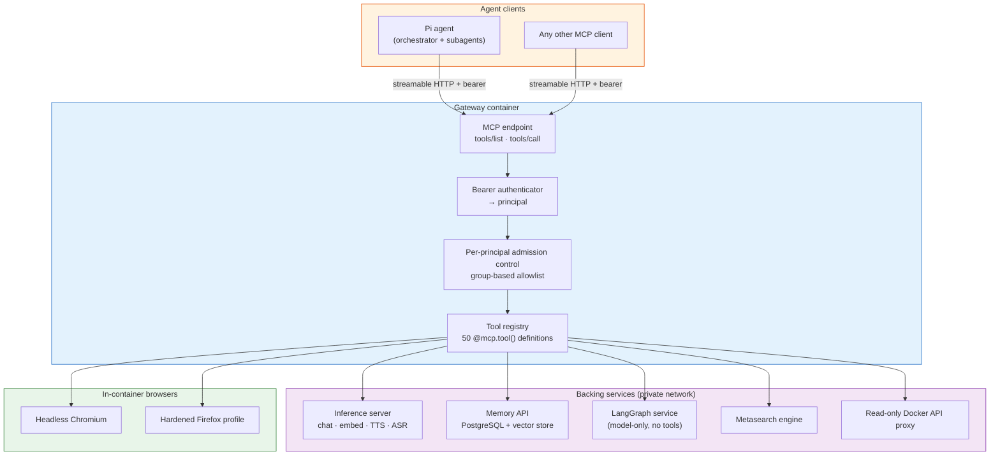
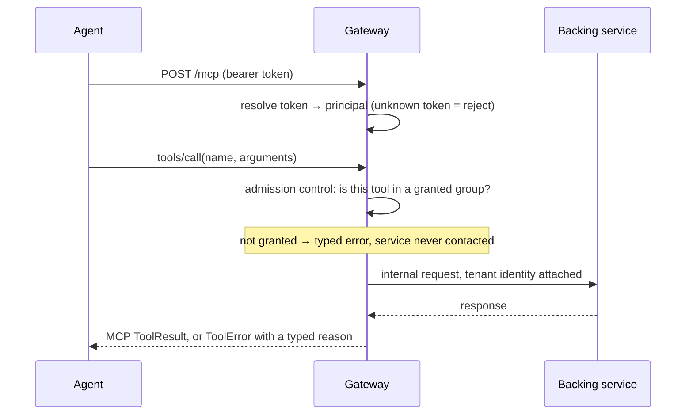
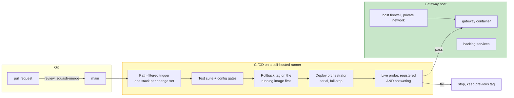

# 🚀 MCP Gateway

**The AI Agent Tool Bridge — exposing internal services as standardized MCP tools**

---

## 📌 What It Is

A **production MCP gateway** that translates internal microservices into standardized
[Model Context Protocol](https://modelcontextprotocol.io/) tools — letting AI agents work with
inference, memory, browsers, media and orchestration through one authenticated endpoint.

**One endpoint. Fifty tools. Per-agent access control that fails closed.**

| | |
|---|---|
| **Protocol** | MCP over streamable HTTP (FastMCP 4.x, Python 3.12) |
| **Consumers** | Pi agents and any other MCP client (IDE agent, CLI agent, SDK) |
| **Registered tools** | 50, in 10 access groups |
| **First deployed** | 2026 |
| **This repo** | Architecture and design documentation — see [What this repo is](#-what-this-repo-is) |

## 🏗️ Architecture

Clients never learn a service URL, a port, or a wire format. They list tools and call tools.
Everything between the `tools/call` and the backend is the gateway's problem: authentication,
authorization, tenant scoping, retries, error typing, and keeping secrets out of the response.

## 🧰 The Tool Surface

50 registered tools, grouped for access control. Groups are the authorization unit — a principal is
granted *groups*, never 50 individual names, so the allowlist cannot rot when a tool is added.

| Group | Count | Tools | What it enables |
|---|---|---|---|
| **memory** | 7 | `memory_search` `memory_store` `memory_stats` `memory_verify` `memory_update` `memory_delete` `memory_restore` | Long-term memory per tenant: semantic search, upsert, soft delete, restore |
| **memory_admin** | 1 | `memory_purge_trash` | Irreversible purge, held by the operator identity only |
| **search** | 6 | `searxng_search` `camo_search` `research` `research_menu` `research_search` `research_fetch` | Self-hosted metasearch and a bounded search → fetch → synthesize loop |
| **browser** | 15 | `browser_navigate` `browser_content` `browser_screenshot` `browser_click` `browser_type` `browser_evaluate` `browser_close` · `camo_navigate` `camo_content` `camo_screenshot` `camo_click` `camo_type` `camo_evaluate` `camo_close` `camo_fingerprint` | Two browser engines: headless Chromium, and a hardened Firefox profile for sites that block automation |
| **llm** | 8 | `gpu_chat` `gpu_embed` `gpu_models` `gpu_stt` `gpu_tts` `langgraph_run` `langgraph_agents` `langgraph_health` | Chat, embeddings, speech in/out, and a small orchestration service |
| **external** | 2 | `external_review` `external_status` | A second opinion from a third-party model — its own group, because it spends a third-party quota and the question leaves the host |
| **yt** | 2 | `yt_transcript` `yt_video_info` | Server-side transcript extraction |
| **email** | 4 | `email_send` `email_pending` `email_cancel` `email_approve` | **Draft-only for agents.** Sending requires a token only a human holds |
| **host** | 4 | `system_status` `docker_ps` `docker_logs` `retention_status` | Operator diagnostics; not granted to ordinary agents |
| **meta** | 1 | `server_instructions` | Self-documenting server: the usage contract shipped to every new client |

A scoped evaluation group (`uat`, 19 tools) exists for trialling the gateway with a real user; it
grants nothing until an allowlist line names it.

## 🔄 Request Lifecycle

| Step | What happens | Failure behaviour |
|---|---|---|
| 1 | JSON-RPC `tools/call` arrives over streamable HTTP | Missing/unknown bearer token → refused before any tool code runs |
| 2 | Token resolves to a **principal** | No line in the allowlist → **no tools**, never a default grant |
| 3 | Admission control checks the tool against the principal's groups | Denied → error returned, backend not contacted, decision logged |
| 4 | Router calls the owning service with the caller's tenant identity | Unreachable/timeout → typed error, never a fabricated result |
| 5 | Result is serialized; internal URLs, headers and secrets stay inside | A partial result is labelled partial, never silently degraded |

## 🔒 Security Model

Full detail in [`docs/SECURITY-MODEL.md`](docs/SECURITY-MODEL.md). The short version:

| Layer | Control | Status |
|---|---|---|
| **Authentication** | Per-agent bearer tokens; unknown token never reaches a tool | enforced |
| **Authorization** | Group-based ACL per principal; a missing entry is a refusal, not a grant | enforced |
| **Tenant isolation** | Memory operations are scoped to the caller's principal at query time; cross-tenant reads return nothing | enforced |
| **Least privilege** | Container talks to Docker through a read-only API proxy: container listing and logs allowed, every write verb refused; a deploy test fails the pipeline if the raw socket mount returns | enforced |
| **Request validation** | URL scheme allowlist and SSRF guard: any hostname resolving to a non-global address (including decimal-encoded forms and every DNS answer) is refused | enforced |
| **Human gate** | Agents can draft email; sending requires a token held by no agent process | enforced |
| **Irreversibility** | Hard delete sits in its own group, defaults off, and requires an explicit confirm | enforced |
| **Audit** | Memory operations recorded with principal, timestamp and action | enforced |
| **Secrets** | Injected as environment variables; nothing in code, nothing in git history | enforced |
| **Transport** | HTTP inside a private network; TLS termination is a documented next step, not a current control | see limitations |

## 🐳 Deployment

| Aspect | Choice | Why |
|---|---|---|
| **Runner** | Self-hosted on the target host | Cloud runners cannot reach private services; the deploy step *is* a local `docker compose` |
| **Trigger** | Path-filtered per stack | A documentation change must not rebuild the gateway |
| **Ordering** | Serial, fail-stop | One bad stack stops the run instead of half-deploying the estate |
| **Rollback** | The running image is tagged before anything is replaced | Rollback is a retag, not a rebuild |
| **Verification** | Health endpoint check plus a live "registered and answering" probe | A container that is up but not serving must fail the deploy |
| **Healthcheck** | `GET /healthz` every 30 s, 3 retries | Proves listener, event loop and auth layer without touching request counters |

## 🧠 Backing Services

| Service | Role | Exposure |
|---|---|---|
| **Inference server** | OpenAI-compatible chat, embeddings, TTS, ASR on GPU | private network, API-keyed |
| **Memory API** | Long-term memory: PostgreSQL + vector store, per-principal tenants, rate limited | loopback |
| **LangGraph service** | Small model-only agent service (no tools of its own) | loopback |
| **Metasearch engine** | Self-hosted aggregation across search engines, with per-engine health tracking | loopback |
| **Browsers** | Headless Chromium + hardened Firefox profile, both in the gateway container | in-container |
| **Docker API proxy** | Read-only façade over the Docker socket | loopback |

The gateway is the only component an agent talks to. Backing services never see an agent, and agents
never see them.

## 🎯 Design Decisions Worth Explaining

| Decision | Reasoning |
|---|---|
| **One server, not a federation** | Every extra hop multiplies failure modes; a single registry keeps `tools/list` authoritative and cheap |
| **Groups, not tool names, in the ACL** | A name list silently becomes wrong the day a tool is added |
| **Typed errors over exception text** | Library exception strings embed the full upstream URL — which is how internal addresses leak into agent context |
| **Partial results are labelled** | A bounded research call that ran out of time returns what it gathered, flagged `partial`, instead of hanging or claiming "no results" |
| **Capabilities advertised, not assumed** | `tools/list` is derived from what is registered *and* granted to this caller, so a client never sees a tool it cannot call |
| **Dependencies pinned exactly** | A `>=` range once pulled a browser build that did not match the pinned profile and killed every browser tool; now one pin, one rebuild, one re-test |
| **Destructive verbs need a verb** | Purge and retention require an explicit confirm and refuse to act when only shown a preview |

## 🧭 Limitations, Honestly

Things this system does **not** do today:

- **No TLS at the gateway.** It listens on a private network and relies on that boundary plus bearer
  tokens. Putting a TLS terminator in front is the next piece of work, and it is listed, not implied.
- **Memory-service rate limiting keys on source address, not principal.** With one gateway in front,
  every agent shares a single budget. Per-principal limiting is open work.
- **A single self-hosted runner.** Deploys and CI queue behind each other; this is a known cost of
  keeping a runner inside the private network.
- **No external reachability.** Nothing here is exposed to the public internet by design; the
  trade-off is that this is a home/lab platform, not a multi-tenant SaaS.

## 📦 Tech Stack

| Component | Technology |
|---|---|
| **Protocol** | Model Context Protocol, streamable HTTP transport |
| **Framework** | FastMCP 4.x on Python 3.12 |
| **Backends** | OpenAI-compatible inference server, FastAPI memory service (PostgreSQL + vector store) |
| **Browsers** | Playwright/Chromium, Camoufox |
| **Media** | Server-side transcript extraction |
| **Container** | Docker Compose, host networking, pinned image tags |
| **CI/CD** | GitHub Actions on a self-hosted runner, path-filtered per-stack deploys |
| **Security** | Bearer auth, group ACL, HMAC-signed service-to-service calls, read-only Docker proxy, host firewall |

## 👉 So, What Did I Prove Here

- **Protocol integration** — turning five heterogeneous services into one coherent, self-describing
  MCP surface that any client can consume without bespoke glue.
- **Security engineering with teeth** — authorization that fails closed, an irreversible-verb design,
  an SSRF guard that survived review, and least-privilege infrastructure access enforced by a
  pipeline gate rather than a convention.
- **Operational discipline** — path-filtered deploys, rollback by retag, health probes that check
  serving and not just starting, exact dependency pinning with a written postmortem behind it.
- **Knowing where the honesty ends** — the limitations section above is the part of the design doc
  most repositories never publish.

## 📁 What This Repo Is

This repository is the **architecture write-up** for a home/lab platform. The implementation lives in
a private repository and is not published: it contains deployment material and configuration specific
to that environment.

**What you get here:** the design, the reasoning, the diagrams, and an honest account of limits.
**What you don't:** runnable source code. Ask, and I will happily walk through the real code in an
interview — the security and error-typing paths are the interesting parts.

Further reading:

| Document | Contents |
|---|---|
| [`docs/ARCHITECTURE.md`](docs/ARCHITECTURE.md) | Components, request path, registry, ACL resolution |
| [`docs/SECURITY-MODEL.md`](docs/SECURITY-MODEL.md) | Threat model, controls, verified vs intended, open items |
| [`docs/OPERATIONS.md`](docs/OPERATIONS.md) | CI/CD, health, rollback, retention, failure playbook |

---

> *One gateway, fifty tools, and every privilege that was not granted has to ask for it.*

