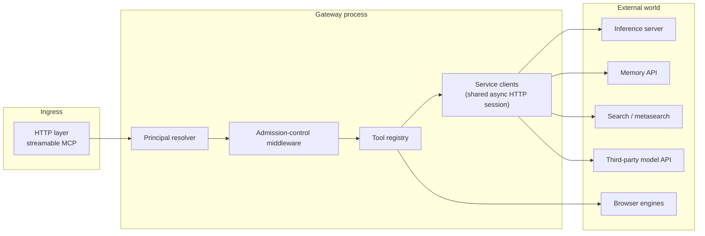
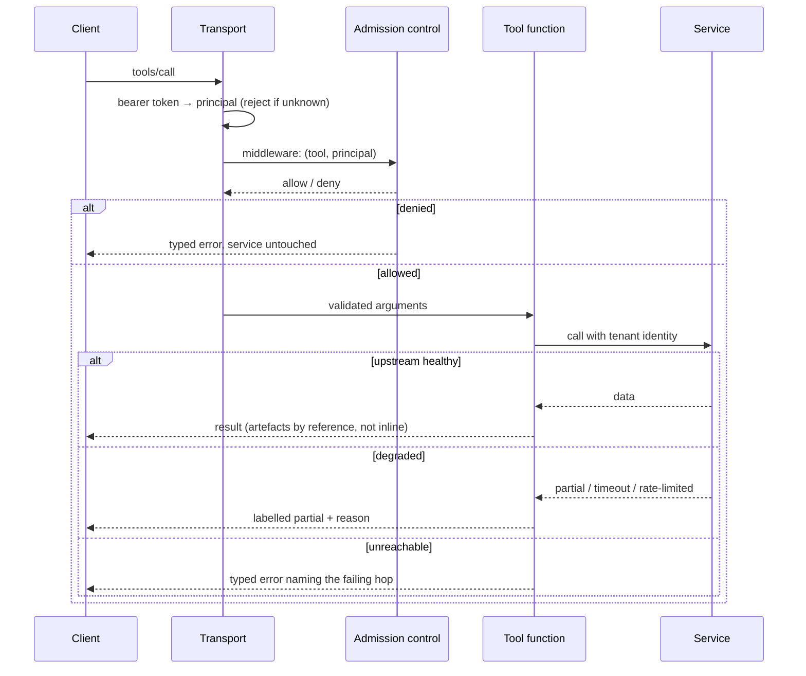
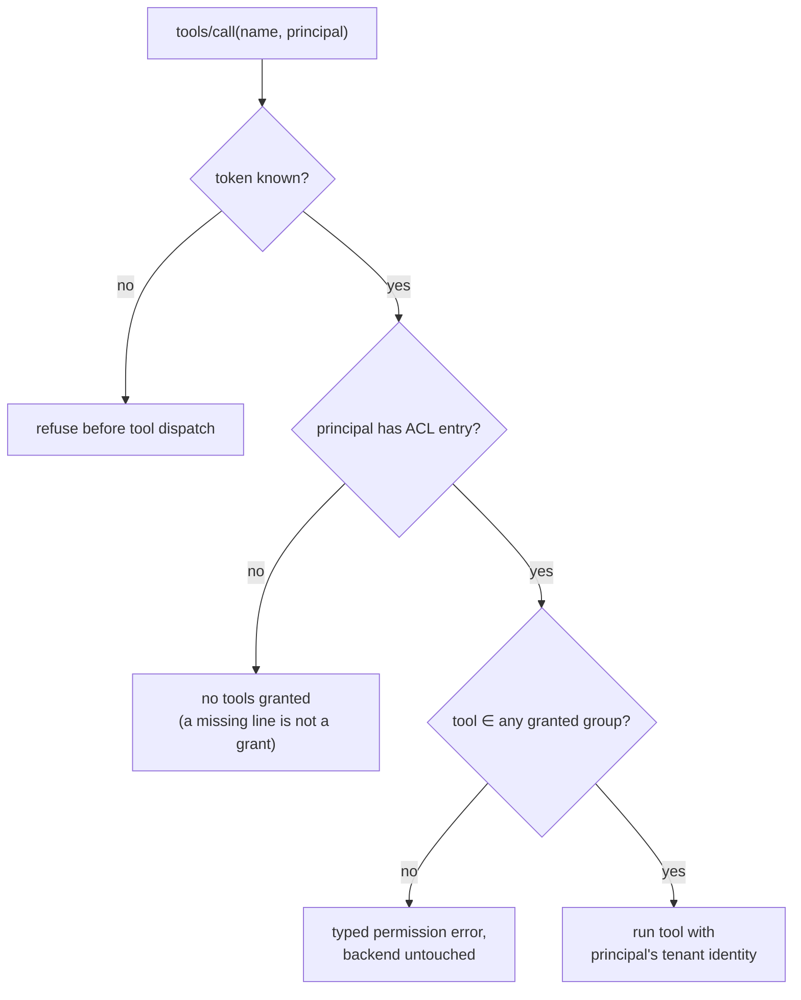

# Architecture

How the gateway is put together, and why each seam sits where it does.

---

## 1. Shape of the system



One process, one event loop, one registry. Deliberately not a micro-kernel: the value of a gateway is
that `tools/list` is authoritative and cheap, and that falls out of having exactly one registry.

| Layer | Responsibility | Explicitly not responsible for |
|---|---|---|
| HTTP/transport | MCP framing, bearer authentication, per-request context | Deciding what a tool means |
| Admission control | Principal → tool permission, before any tool body runs | Tenant scoping inside a service |
| Tool registry | Argument validation, error typing, result shaping | Business rules of the backing service |
| Service clients | Retries, timeouts, typed error translation | Choosing whether the call is allowed |

## 2. The registry

Every tool is one decorated async function:

```python
@mcp.tool()
async def memory_search(query: str, limit: int = 10, scope: str = "") -> dict:
    """Semantic search across the calling principal's own memory space."""
```

Registration is the *only* publication step — there is no manifest, no generated client, no per-tool
config entry to forget. That removes a whole class of "documented but not wired" defects.

The advertised capability set is computed, not declared: it is derived from what is registered and
then filtered by the caller's grants. A client therefore cannot see a tool it is not allowed to call,
which is the opposite of the common pattern where `tools/list` is a superset and calls fail at runtime.

## 3. Request path, in order



Three rules that survive code review better than any amount of guidance:

1. **Never leak the upstream URL.** HTTP client exception strings embed the full request URL, which is
   how an internal address ends up in an agent's context window. Error translation takes the status
   code and a category, never the library's `__str__`.
2. **A partial is a first-class result.** A bounded call that ran out of its time budget returns what
   it gathered with `partial: true` and a reason. Claiming "no results" when a backend failed is a
   fabricated negative, and it is the failure mode that wastes the most downstream effort.
3. **Bulk leaves by reference.** Screenshots, audio and transcripts are written to managed storage and
   returned as a path plus metadata. Returning base64 in a tool result is how a 200-token answer turns
   into a 200k-token context.

## 4. Access resolution



The ACL is expressed as **groups**, because a list of 50 tool names becomes silently wrong the moment
tool 51 is added. A group that exists but is not granted grants nothing — which is what makes adding a
new group to the code safe.

Two group boundaries are load-bearing rather than cosmetic:

- **`memory_admin` separate from `memory`** — purge-trash wipes every trashed row in a tenant. The
  memory service already scopes it to the tenant, so this is blast-radius control, not tenant control.
- **`external` separate from `llm`** — an external review spends a third-party quota and the question
  leaves the host. Those are properties of the tool, so they get their own grant.

The evaluation group (`uat`) documents its exclusions by property: browser JavaScript execution reads
cookies and local storage of whatever page is loaded, so it is an escape hatch around "read-only
browsing"; click and type verbs can submit someone else's form; host diagnostics can surface other
tenants' log lines.

## 5. Service seams

| Seam | Transport | Identity | Notable behaviour |
|---|---|---|---|
| Inference | HTTP, OpenAI-compatible | API key per consumer | One completion per call, asserted by a test — a reasoning model that emitted an extra completion used to double billed output |
| Memory | HTTP + HMAC | Secret per principal, fail-closed | Cross-tenant reads return nothing; admin verbs restricted at the database role level, not only in code |
| Orchestration service | HTTP | service-level | Model-only by design: it advertises no tools, because a model that emits a tool call it cannot execute is a worse failure than a plain answer |
| Metasearch | HTTP | none needed | Per-engine health tracking with a bounded cooldown; a cooling engine is omitted from the request rather than retried into another failure, and identical queries share one in-flight upstream call |
| Docker | HTTP over a loopback proxy | none — the proxy is the boundary | Container list and logs allowed, every write verb refused, enforced outside the application |

## 6. Browser subsystem

Two engines because they fail differently: a fast headless Chromium for normal pages, and a hardened
Firefox profile for sites that block automation. Both live in the gateway container, and both are
pinned as a *pair* — the library version and the browser build must match, which is the exact bug that
made every browser tool die at launch once the pair drifted (see [OPERATIONS](OPERATIONS.md#5-the-pinning-postmortem)).

Per-client page lifecycle is explicit: each client gets its own page, closing a page releases its
context and, if it was the last one, the browser process. Idle pages are reaped by a background
sweep. "Open a browser" is a resource with a lifetime, and treating it as one is what keeps a
long-lived gateway from becoming a memory leak.

## 7. What is deliberately absent

| Absent | Because |
|---|---|
| A database in the gateway | The gateway is a router; state belongs to the memory service, where tenancy is enforced |
| Per-tool config files | Registration is the publication step; a config entry per tool is a drift generator |
| Retries everywhere | A retry on a non-idempotent verb is a bug; the two calls that retry are the two that are safe |
| A plugin system | Five services do not justify a plugin ABI; adding a tool is a decorator |
| Inline binary payloads | Context is the scarce resource — see rule 3 in §3 |
