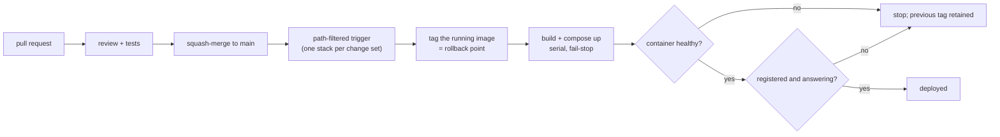

# Operations

How it is built, shipped, watched, and rolled back — and the incidents that shaped those choices.

---

## 1. Pipeline

| Stage | Behaviour | Rationale |
|---|---|---|
| Trigger | Path-filtered per stack | Editing documentation must not rebuild a container |
| Runner | Self-hosted, on the target host | Cloud runners cannot reach private services; the deploy step is a local `docker compose` |
| Ordering | Serial and fail-stop | One failing stack halts the run instead of leaving a half-deployed set |
| Rollback point | The currently running image is tagged before replacement | Rollback is a retag, never a rebuild under pressure |
| Post-deploy probe | Health endpoint **and** a live "registered and answering" check | A process that is up but not serving must fail the run |

`deploy` deliberately does not cancel in-progress runs, while tests do: cancelling a deploy mid-stack
is how you get a container set with mismatched versions.

## 2. Runtime monitoring

| Signal | Source |
|---|---|
| Liveness | Container healthcheck: `GET /healthz` every 30 s, timeout 10 s, 3 retries, 60 s start period |
| Metrics | Prometheus scraping the gateway; container metrics exported separately |
| Request log | Structured per-call record: tool, principal, latency, outcome |
| Resource use | Container metrics plus per-artefact disk usage |
| Idle cleanup | Background sweeper closes abandoned browser pages on a fixed interval |

The healthcheck probes a dedicated endpoint rather than the MCP path on purpose: an unauthenticated
probe against the request path increments the same rejection counters that operators watch, so the
monitor inflates the very signal it is reading. The dedicated endpoint proves listener, event loop and
auth layer without touching them. Detection is detection — restart policy is configured separately and
does not act on health.

## 3. Failure behaviour

| Failure | What the caller sees | Design intent |
|---|---|---|
| Backend unreachable | Typed error naming the hop | Never a silent empty list, which reads as "nothing exists" |
| Backend degraded mid-task | `partial: true` plus gathered findings and a reason | Work done is not thrown away; the caller is not lied to |
| Search engine rate-limited | That engine enters a bounded cooldown and is omitted from the next request, with `retry_after` surfaced | Retrying a rate-limited engine into another failure wastes the budget |
| Identical query twice inside a short window | Served from a bounded cache, or joined to one in-flight upstream request | A fan-out of clones must not become a self-inflicted denial of service |
| Anti-bot wall | A documented ladder: direct → feed/API → alternate engine → archive → human | A `403` is a rung, not an answer; archive hits are labelled `archive`, never `read` |
| Tool deadline reached | Partial transcript returned | A short deadline beats a patient one: the evidence survives, only the last message is lost |

## 4. Retention

Generated artefacts (transcripts, screenshots, audio) are swept on a fixed age policy. Three rules
make it safe to leave running:

1. **Memories are never auto-deleted** — retention touches generated files only.
2. **Dry run is the default** — the tool previews what would be removed.
3. **A destructive run needs a confirm flag** — and refuses, rather than deleting, when asked to
   preview. A tool shaped like a preview must never delete by accident.

## 5. The pinning postmortem

Every dependency used to be a `>=` range. One rebuild pulled a browser library that was one patch
newer than the tested image, which fetched a browser build that did not match the browser profile
stored on a volume — and every browser tool died at launch with an executable-not-found error. Nothing
in the diff explained it, because nothing in the diff had changed.

The fix was not "bump the version":

- Every dependency is pinned to the exact version inside the last verified-working image.
- The browser library and the browser **build** are pinned separately, because they are two artifacts
  that have to agree — the profile on disk is keyed to the build.
- The Dockerfile asserts the expected executable exists at build time, so an unbuildable image fails
  the build instead of starting and then failing every call.
- The upgrade procedure is one pin, one rebuild, one live re-test of the browser tools.

The lesson generalizes: pin the *pair*, and make the build prove the pair is present.

## 6. Known operational weaknesses

| Weakness | Evidence | Mitigation today |
|---|---|---|
| One runner serves CI and deploys | Red runs that are queue starvation, not code | Path filtering; cancels on tests but never on deploys |
| Deploys are only as good as the probe | A container that starts but does not serve would otherwise pass | The post-deploy check requires "registered and answering" |
| Free-plan limits on the forge | Branch protection and required status checks cannot be enforced on this plan | Squash-merge with human review; no gate is claimed where none exists |
| Silent config drift | A tool-registry count in a source comment drifted from the real registry | Registry count is asserted from the live server, not from a constant |

## 7. Change checklist

Adding a tool, in the order that keeps the guarantees true:

1. One `@mcp.tool()` function; validation and error typing inside it.
2. Add its name to exactly one `TOOL_GROUPS` entry — the group decides who may call it.
3. Return artefacts by reference if the payload is large or binary.
4. Add a test that calls it through the MCP surface, not the function directly.
5. If it takes a URL, prove the guard refuses a non-global address.
6. Confirm it disappears from `tools/list` for a principal that was not granted its group.
