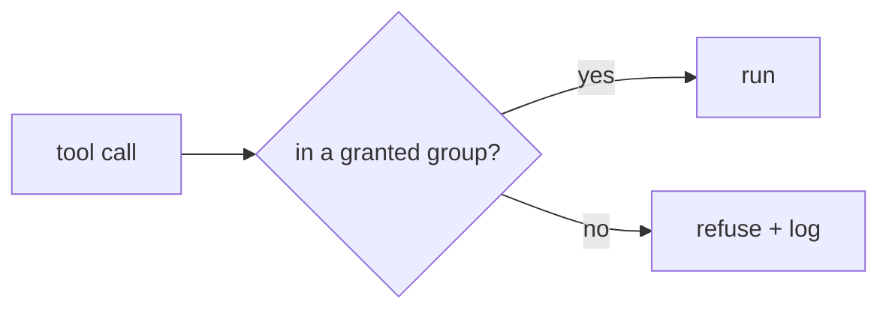
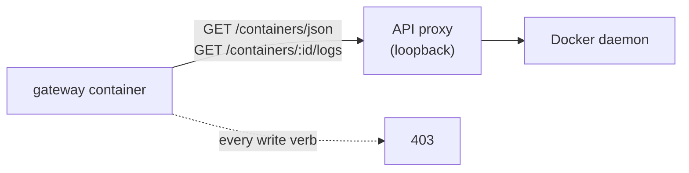

# Security Model

What is actually enforced, how it was verified, and what is still open. Controls are marked
**enforced** (code path exists and was exercised), **gated** (a pipeline check keeps it true), or
**open** (documented, not implemented). Nothing here is marked enforced because it was intended.

---

## 1. Threat model

The platform is a single-operator system on a private network. The assumption being defended against
is not "the internet is at the door" — it is **"an agent is trusted to do work and can be wrong,
tricked, or prompt-injected."**

| Threat | Addressed by | Status |
|---|---|---|
| Unauthenticated caller reaches a tool | Bearer authentication before dispatch | enforced |
| One agent reads another's memory | Principal-scoped queries at the memory service, fail-closed | enforced |
| Agent escalates against the host it runs on | `host` group not granted to ordinary agents; Docker access read-only by construction | enforced |
| Prompt-injected agent exfiltrates via network | SSRF guard on every URL-taking tool | enforced |
| Agent sends real email / destroys data | Draft-only verbs, separate approval token, admin-only irreversible verbs | enforced |
| Tool output leaks internal topology | Error translation that never carries upstream URLs | enforced |
| Attacker on the network path sees tokens | TLS at the gateway | **open** |
| One agent exhausts a shared budget | Rate limiting keyed on source address, not principal | **open** (partial) |
| Compromised dependency drifts a runtime | Exact pins, per-dependency postmortem, rebuild-and-retest procedure | enforced |

## 2. Authentication

One bearer token per agent identity. An unknown or absent token is refused at the HTTP edge — the
memory service additionally answers unauthenticated requests with a bare `401` before any handler
runs, so failing closed is not something a code path can accidentally opt out of.

A token maps to a **principal**, and the principal is the identity used for everything downstream:
which tools exist for this caller, and which memory tenant it can see. `tools/list` is filtered by the
same identity, so a client cannot enumerate a capability it does not hold.

## 3. Authorization

Design choices that matter more than the check itself:

| Choice | Consequence |
|---|---|
| Deny by default; a missing ACL entry is **not** a grant | Adding a principal cannot accidentally create a wildcard |
| Grants name groups, not tool names | A newly added tool is invisible until someone grants its group |
| A defined-but-ungranted group grants nothing | Introducing a group in code is inert by construction |
| Host reconnaissance and mail live outside ordinary grants | An agent that cannot profile its machine cannot inventory it for a later step |
| Irreversible verbs are separate groups | Blast radius is a permission, not a runtime argument |

## 4. Tenant isolation

Memory operations are scoped to the calling principal at query time — not by a filter the caller can
supply. Cross-tenant reads return nothing rather than an error, and the database role used by the
application holds only the privileges its endpoints need, so an endpoint bug is not an escalation to
full-table access. Administrative memory verbs are additionally restricted at the route layer.

## 5. Infrastructure access, the honest version

The gateway needs to answer "what is running and what did it log". The first implementation mounted
the Docker socket into the container. That is root-equivalent host control reachable from a
network-facing service, and it was found by reading the compose file rather than by an incident.

The current design:

- No socket in the container filesystem — the API is reached over a loopback address.
- Two read verbs allowed; everything else refused by the proxy, not by application code.
- A **pipeline check fails the deploy** if the raw socket mount ever reappears. The control is
  structural: nobody has to remember this in six months.

## 6. Input validation and SSRF

Every tool that accepts a URL runs through one guard:

1. Scheme allowlist (`http`, `https`) — anything else is rejected as an unsupported scheme.
2. Host resolution: every DNS answer, not just the first, is checked; any non-global address is
   refused.
3. Numeric literal forms are normalized before the check, so a decimal-encoded loopback address is
   refused rather than parsed as a public host.

This is where browser tools and fetch tools converge: the guard sits in the fetch path, so a page
cannot be steered into an internal endpoint by a link it was told to click.

## 7. Destructive and irreversible operations

| Verb | Control |
|---|---|
| Soft delete | Reversible by design; the row stays until purge |
| Purge trash | Separate group; requires an explicit confirm; refuses to act on preview intent |
| Retention cleanup | Dry run by default; a destructive run requires a confirm flag, and refuses rather than deleting when asked to preview |
| Email send | Agents can only draft; transmit requires an approval token the harness does not hand to agent code, plus a per-day limit and an audit record |

The email control is the one with a caveat worth stating: it is a token requirement plus operator
policy, not cryptography. A principal deliberately given the token *can* send. The point of the design
is that no agent acquires it by accident, and that every send is attributable.

## 8. Data handling in results

- Binaries and long text are written to managed storage; the result carries a path plus metadata.
- Error strings are translated: status code and category, never the HTTP library's exception text,
  which embeds the full upstream URL.
- Tool descriptions may contain a real example, never a credential, token shape, or internal address —
  descriptions are the most-read part of the interface and the cheapest thing to leak through.

## 9. Auditability

Memory operations are recorded with principal, timestamp, and action; the application role may insert
and read those rows and nothing else. Container logs carry request identity, latency, and outcome for
every tool call. Generated artefacts are swept on a retention policy that never touches memories.

## 10. Open items

| Item | Why it is open | Impact today |
|---|---|---|
| TLS in front of the gateway | Everything is on a private network; the terminator has to live somewhere without breaking the health probe | Bearer tokens travel unencrypted inside that boundary |
| Per-principal rate limiting | The limiter in the memory service keys on source address, and all agent traffic arrives through one gateway | One chatty agent can consume the shared budget |
| Runner capacity | Deploys and CI share one self-hosted runner inside the private network | Queue latency, and red runs that are queue starvation rather than code |
| Health of the whole estate | The gateway probes what it calls; nothing probes the gateway's *callers* | Failure detection depends on the deploy probe and the container healthcheck |

## 11. How to review this quickly

The three highest-value code paths, in order:

1. The admission-control middleware — one function, the entire authorization decision.
2. The URL guard — short, and the place to test a hostile address literal.
3. The error-translation helper — small, and it is what keeps topology out of agent context.
